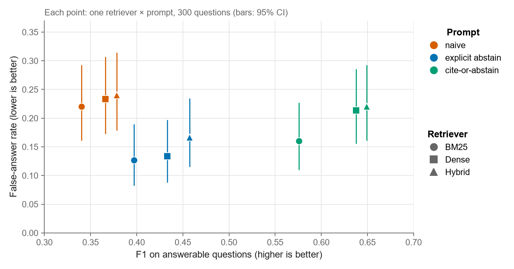
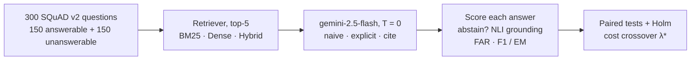
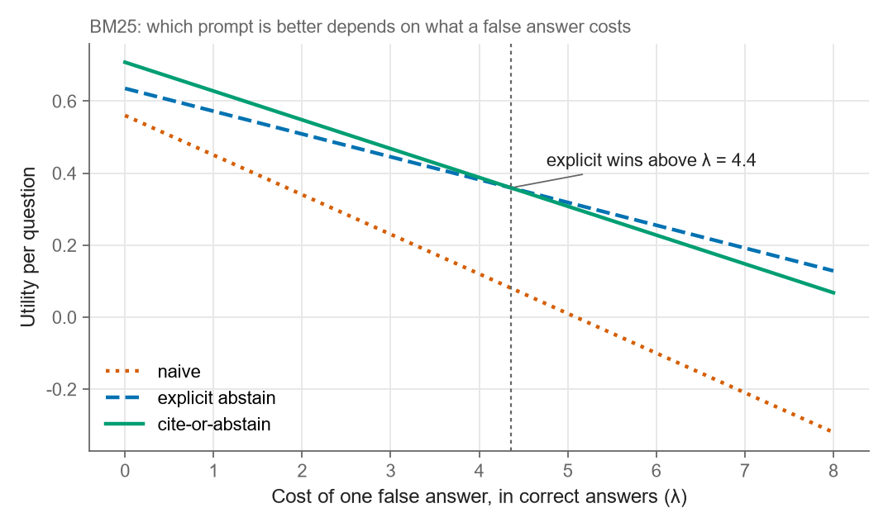

# When Should RAG Answer? Cite-or-Abstain Prompting on Unanswerable Questions

A controlled study of when a retrieval-augmented LLM should decline to answer. On 300 SQuAD v2 questions, half of them unanswerable, an explicit abstain instruction cut false answers from 0.22–0.24 to 0.13–0.17. A cite-or-abstain prompt reached answer F1 of 0.58–0.65, against 0.40–0.46 for the explicit prompt.

**English** · [中文](README.zh-CN.md)

<p align="center">
  
  <br><em>Explicit abstain (blue) gives the fewest false answers, cite-or-abstain (green) the best answers, and naive prompting (orange) is worst on both.</em>
</p>

## Results

- **Explicit abstain gives the fewest false answers.** FAR is 0.127 / 0.133 / 0.167 for BM25 / Dense / Hybrid, against 0.220 / 0.233 / 0.240 for naive. The drop is significant after Holm correction for BM25 (p = 0.0015) and Dense (p = 0.0030).
- **Cite-or-abstain gives the most accurate answers.** Its F1 is 0.576 / 0.638 / 0.649, against 0.397–0.457 for explicit and 0.340–0.379 for naive (sign test, corrected p ≤ 1e-7). Its false-answer rate does not differ significantly from either prompt.
- **The better prompt depends on what a false answer costs.** Explicit wins once one false answer costs more than 1.6–4.4 correct answers (λ* = 4.4 / 1.6 / 2.6, wide CIs).
- **Most false answers come from planted distractors.** 71–95% of them quote the paragraph SQuAD v2 used to write the unanswerable question.

All code, the 300-question set and the full results of the final run are included. Every number here can be recomputed offline in about a minute.

## How it works



Each question goes through all 3 × 3 combinations of retriever and prompt, which gives 2,700 generations. Because every configuration answers the same questions, all comparisons are paired tests on the same items.

The three prompts differ only in how they treat missing evidence:
- **naive** just answers;
- **explicit** is told to abstain when the context is insufficient;
- **cite** must return a verbatim supporting quote and a short answer span, or abstain.

| Component | Choice |
|---|---|
| Data | 300 SQuAD v2 questions (150 answerable + 150 unanswerable, seed 42); retrieval corpus of 20,000 paragraphs |
| Retrievers (top-5) | **BM25** (`rank_bm25`), **Dense** (`BAAI/bge-small-en-v1.5` + FAISS), **Hybrid** (reciprocal-rank fusion, k = 60) |
| Generator | `gemini-2.5-flash` on Vertex AI, temperature 0 |
| Grounding verifier | NLI cross-encoder `cross-encoder/nli-deberta-v3-small` |
| Statistics | Exact McNemar (false answers), sign test (F1), paired bootstrap (2,000 resamples), Holm correction over 12 comparisons |

**Metrics**

- **FAR** (false answer rate) = answered unanswerable questions / 150 unanswerable questions.
- **Coverage** = answered answerable questions / 150 answerable questions.
- **F1 / EM**: SQuAD-normalised, averaged over *all* answerable questions; an abstention scores 0.
- **U_rel(λ)** = (Σ F1 of answered answerable + #correct abstentions − λ · #false answers) / N.
- **U_biz(γ)** = (Σ F1 of answered answerable − β · #false answers − γ · #wrongly refused answerable) / N, with β = 1.

## Full results

| Config | False answers | FAR ↓ | Coverage | F1 (all answerable) ↑ | EM ↑ | U_rel(λ=1) ↑ |
|---|---|---|---|---|---|---|
| BM25 · naive | 33 | 0.220 | 0.760 | 0.340 | 0.147 | 0.450 |
| BM25 · explicit | 19 | **0.127** | 0.713 | 0.397 | 0.213 | 0.572 |
| BM25 · cite | 24 | 0.160 | 0.767 | **0.576** | **0.427** | **0.628** |
| Dense · naive | 35 | 0.233 | 0.867 | 0.366 | 0.133 | 0.450 |
| Dense · explicit | 20 | **0.133** | 0.773 | 0.433 | 0.240 | 0.583 |
| Dense · cite | 32 | 0.213 | 0.820 | **0.638** | **0.453** | **0.606** |
| Hybrid · naive | 36 | 0.240 | 0.873 | 0.379 | 0.147 | 0.449 |
| Hybrid · explicit | 25 | **0.167** | 0.807 | 0.457 | 0.267 | 0.562 |
| Hybrid · cite | 33 | 0.220 | 0.853 | **0.649** | **0.447** | **0.604** |

Retrieval Recall@5 = 0.720 / 0.770 / 0.833 and MRR@5 = 0.589 / 0.642 / 0.690 (BM25 / Dense / Hybrid).

<p align="center">
  
  <br><em>With BM25, cite-or-abstain has higher utility while false answers are cheap. Explicit abstain takes over once a false answer costs more than about 4.4 correct answers.</em>
</p>

**More findings** (all comparisons use the same retriever and are paired):

- For Hybrid, explicit < naive has p = 0.007 before correction and 0.074 after.
- Part of cite's F1 gain may come from its short-span answer format (median 3 words vs 5–7). No ablation separates the quote requirement from the span requirement.
- The quote check never fired: 0 of 900 cite answers were rejected because the quote was not in the context.
- Cite has the highest U_rel point estimate, but the confidence interval of its difference from explicit includes 0.
- With the cite prompt, FAR and F1 do not differ significantly between retrievers.
- FAR is much higher when the distractor paragraph is retrieved (e.g. BM25 · cite 0.208 vs 0.045). This is an association, not a causal result.
- A learned answer/abstain gate gives no stable out-of-sample gain for cite (5-fold CV) and helps only naive (+0.025 to +0.059).
- Falling back from cite to explicit pays off only when a wrongly refused question costs more than γ* = 2.0 / 0.75 / 3.1.

## Limitations

- One generator (temperature 0) and one adversarial dataset.
- n = 150 per cell, so FAR confidence intervals are about ±0.06.
- One gold answer per question, so F1 and EM are lower bounds that penalise long answers.
- The 257 false answers in `outputs_v3/false_answer_audit.csv` have not been labelled by hand.

## Reproduce

Install PyTorch (CPU or CUDA build) first, then:

```bash
pip install -r requirements.txt
```

### 1. Check the shipped numbers (free, no GPU, no cloud account)

```bash
python tests/test_unit.py
python scripts/00_smoke_test.py --offline
python scripts/12_rigor_checks.py > my_rigor_checks.txt
diff my_rigor_checks.txt outputs_v3/rigor_checks.txt    # should print nothing
python scripts/13_figures_v3.py                          # writes figures/small and figures/large
python scripts/14_readme_figures.py                      # writes docs/images (the figures in this README)
```

### 2. Full re-run

You need a Google Cloud project with the Vertex AI API enabled. Script 03 makes 2,700 Gemini calls, which costs a few US dollars and takes about 40 minutes at `--concurrency 4`. Scripts 02 and 04 run on CPU but are much faster on a GPU.

```bash
gcloud auth application-default login
export GCP_PROJECT=<your-project-id>
export GCP_LOCATION=us-central1                # default
export GEMINI_MODEL_ALIAS=gemini-2.5-flash     # required; the default alias is retired

python scripts/check_gcp.py
python scripts/01_build_data.py --n_queries 300 --corpus_size 20000
python scripts/02_run_retrieval.py
python scripts/03_generate.py --concurrency 4  # if you hit 429 errors: export GEMINI_RPM=20
python scripts/03d_cite_breakdown.py
python scripts/04_grounding.py
python scripts/05_evaluate.py
python scripts/07_multisignal_gate.py
python scripts/08_business_analysis.py --retriever BM25
python scripts/10_paired_tests.py
python scripts/11_false_answer_audit.py

RAG_OUTPUT_SUBDIR=outputs python scripts/12_rigor_checks.py   # compare with outputs_v3/rigor_checks.txt
```

- A fresh run writes to `outputs/`, so the shipped `outputs_v3/` is never overwritten. Set `RAG_OUTPUT_SUBDIR` to choose another folder.
- `01_build_data.py` rebuilds `data/queries.jsonl` with seed 42 and also writes the 20,000-paragraph `data/corpus.jsonl`.
- Hosted models change over time, so a re-run may differ slightly from `outputs_v3/` even at temperature 0. In the shipped diagnostic, 30/30 cite questions generated twice kept the same outcome and 28/30 gave the identical answer string.

## Repository layout

```
├── raglib/                 core library
│   ├── config.py           paths, model ids, hyperparameters (env-var overrides)
│   ├── data.py             SQuAD v2 loader, corpus/query builder, jsonl helpers
│   ├── retrievers.py       BM25 / Dense / Hybrid (RRF)
│   ├── generator.py        Gemini generator (3 prompts, typed JSON schema for cite) + mock generator
│   ├── grounding.py        NLI claim-grounding verifier + mock scorer
│   ├── abstention.py       abstention detection, 2x2 answer/abstain matrix, FAR
│   ├── metrics.py          Recall@k, MRR@k, SQuAD F1 / EM
│   └── evaluate.py         joins everything into summary tables
├── scripts/                pipeline steps (see below)
├── tests/test_unit.py      unit tests
├── data/queries.jsonl      the 300 questions used in the study
├── docs/images/            README figures (English and Chinese)
├── outputs_v3/             full results of the final run
└── outputs_v3_diag/        30 cite questions generated a second time (determinism check)
```

| Script | What it does | Cost |
|---|---|---|
| `00_smoke_test.py` | `--stage env` checks imports and GPU; `--offline` runs the whole pipeline on a toy set with mock models | free |
| `01_build_data.py` | builds the corpus and the balanced question set from SQuAD v2 | free |
| `02_run_retrieval.py` | runs the three retrievers, reports Recall@k and MRR@k | free |
| `03_generate.py` | calls Gemini and caches every answer (re-running only fills in missing ones) | **paid** |
| `03d_cite_breakdown.py` | splits cite outputs into answered / declined / unverified quote / format failure | free |
| `04_grounding.py` | NLI grounding scores for every answer | free |
| `05_evaluate.py` | main tables → `summary.json` | free |
| `06_gate_curve.py` | grounding-threshold gate curves | free |
| `07_multisignal_gate.py` | learned multi-signal gate, AURC, bootstrap | free |
| `08_business_analysis.py` | cite → explicit cascade and cost-weighted utility (γ) | free |
| `10_paired_tests.py` | McNemar, paired bootstrap, crossover CIs | free |
| `11_false_answer_audit.py` | where false answers come from + audit CSV (needs the full corpus) | free |
| `12_rigor_checks.py` | recomputes the main table and all tests from `generations.jsonl` alone | free |
| `13_figures_v3.py` | result figures → `figures/` | free |
| `14_readme_figures.py` | README figures in English and Chinese → `docs/images/` | free |
| `check_gcp.py` | one tiny Gemini call to check Vertex AI access | ~free |

## Result files (`outputs_v3/`)

| File | Content |
|---|---|
| `generations.jsonl` | 2,700 rows (300 questions × 3 retrievers × 3 prompts) with the answer; the 900 cite rows also keep the raw response, finish reason and cite outcome |
| `retrieval.jsonl` | top-5 passage ids and scores per question and retriever |
| `grounding.jsonl` | NLI grounding scores per answer |
| `summary.json` | main tables (from script 05) |
| `paired_tests.json` | paired significance tests and crossover CIs (script 10) |
| `multisignal_gate.json`, `business_analysis.json` | gate and cascade analyses (scripts 07, 08) |
| `false_answer_sources.json`, `false_answer_audit.csv` | false-answer sources; the CSV has an empty `label` column for manual audit (script 11) |
| `cite_breakdown.json` | cite outcome classes (script 03d) |
| `rigor_checks.txt` | output of script 12 |
| `figs/` | figures from scripts 05 and 08 |

## Links

- Portfolio: https://tjiewgnil.github.io/#rag

## License

Code and results are released under the [MIT License](LICENSE).

Questions, passages and gold answers come from [SQuAD 2.0](https://rajpurkar.github.io/SQuAD-explorer/) (Rajpurkar et al., 2018), which is distributed under CC BY-SA 4.0. The files in `data/` and `outputs_v3*/` contain SQuAD text and keep that license.
