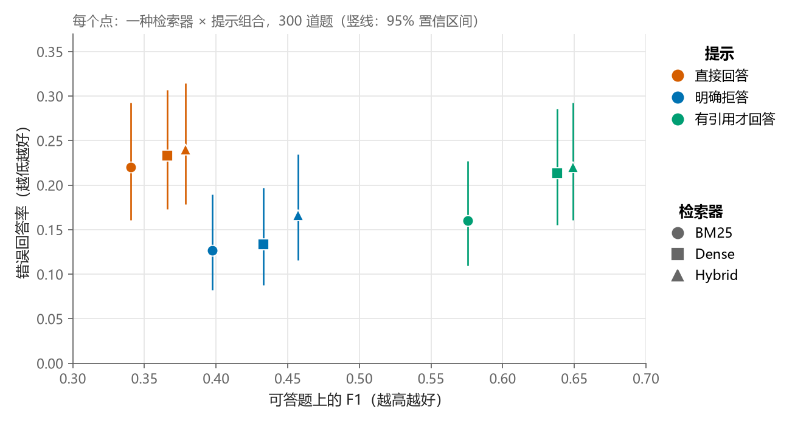
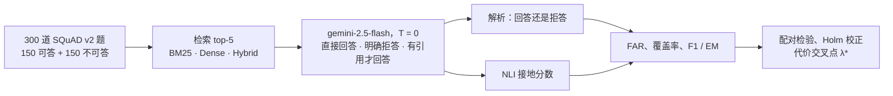
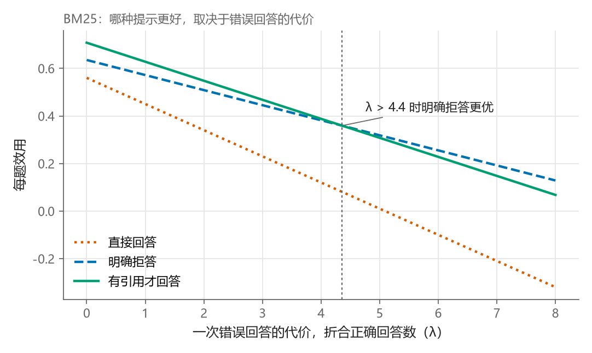

# RAG 什么时候该回答？在不可答问题上测试"有引用才回答"提示

这是一项受控实验：检索增强的 LLM 什么时候应该拒绝回答。在 300 道 SQuAD v2 题上（一半在证据里找不到答案），明确的拒答指令把错误回答率从 0.22–0.24 降到 0.13–0.17。"有引用才回答、否则拒答"的提示把答案 F1 提高到 0.58–0.65，明确拒答提示为 0.40–0.46。

[English](README.md) · **中文**

<p align="center">
  
  <br><em>明确拒答（蓝）错误回答最少，有引用才回答（绿）答案质量最高，直接回答（橙）两项都最差。</em>
</p>

## 成果

- **明确拒答的错误回答最少。** BM25 / Dense / Hybrid 下错误回答率（FAR）分别为 0.127 / 0.133 / 0.167，直接回答为 0.220 / 0.233 / 0.240。经 Holm 校正后，BM25（p = 0.0015）和 Dense（p = 0.0030）上的下降仍然显著。
- **有引用才回答的答案最准。** F1 为 0.576 / 0.638 / 0.649，明确拒答为 0.397–0.457，直接回答为 0.340–0.379（符号检验，校正后 p ≤ 1e-7）。它的错误回答率和另外两种提示相比没有显著差异。
- **该用哪种提示，取决于错误回答的代价。** 当一次错误回答的代价超过 1.6–4.4 次正确回答时，明确拒答更好（λ* = 4.4 / 1.6 / 2.6，置信区间较宽）。
- **多数错误回答来自题目里埋的干扰段落。** 71–95% 的错误回答引用的是 SQuAD v2 出这道不可答题时所用的段落。

仓库包含全部代码、300 道题和最终实验的完整结果。这里的每个数字都能离线重算，大约一分钟。

## 工作原理



每道题都要经过 3 种检索器 × 3 种提示的全部组合，共 2,700 次生成。所有配置回答的是同一批题，所以每个比较都是同一批题上的配对检验。

三种提示只在"证据不够时怎么办"上不同：
- **直接回答（naive）**：直接作答；
- **明确拒答（explicit）**：上下文不足时要求拒答；
- **有引用才回答（cite）**：必须给出原文引文和简短的答案片段，否则拒答。

| 组成 | 选择 |
|---|---|
| 数据 | 300 道 SQuAD v2 题（150 可答 + 150 不可答，seed 42）；检索语料 20,000 段 |
| 检索器（top-5） | **BM25**（`rank_bm25`）、**Dense**（`BAAI/bge-small-en-v1.5` + FAISS）、**Hybrid**（倒数排名融合，k = 60） |
| 生成模型 | Vertex AI 上的 `gemini-2.5-flash`，temperature 0 |
| 接地校验 | NLI 交叉编码器 `cross-encoder/nli-deberta-v3-small` |
| 统计 | 精确 McNemar 检验（错误回答）、符号检验（F1）、配对 bootstrap（2,000 次重采样），12 组比较做 Holm 校正 |

**指标**

- **FAR**（错误回答率）= 回答了的不可答题数 / 150 道不可答题。
- **覆盖率** = 回答了的可答题数 / 150 道可答题。
- **F1 / EM**：按 SQuAD 规则归一化，对*全部*可答题取平均；拒答记 0 分。
- **U_rel(λ)** =（已回答可答题的 F1 之和 + 正确拒答数 − λ · 错误回答数）/ N。
- **U_biz(γ)** =（已回答可答题的 F1 之和 − β · 错误回答数 − γ · 错拒的可答题数）/ N，β = 1。

## 完整结果

| 配置 | 错误回答 | FAR ↓ | 覆盖率 | F1（全部可答题）↑ | EM ↑ | U_rel(λ=1) ↑ |
|---|---|---|---|---|---|---|
| BM25 · 直接回答 | 33 | 0.220 | 0.760 | 0.340 | 0.147 | 0.450 |
| BM25 · 明确拒答 | 19 | **0.127** | 0.713 | 0.397 | 0.213 | 0.572 |
| BM25 · 有引用才回答 | 24 | 0.160 | 0.767 | **0.576** | **0.427** | **0.628** |
| Dense · 直接回答 | 35 | 0.233 | 0.867 | 0.366 | 0.133 | 0.450 |
| Dense · 明确拒答 | 20 | **0.133** | 0.773 | 0.433 | 0.240 | 0.583 |
| Dense · 有引用才回答 | 32 | 0.213 | 0.820 | **0.638** | **0.453** | **0.606** |
| Hybrid · 直接回答 | 36 | 0.240 | 0.873 | 0.379 | 0.147 | 0.449 |
| Hybrid · 明确拒答 | 25 | **0.167** | 0.807 | 0.457 | 0.267 | 0.562 |
| Hybrid · 有引用才回答 | 33 | 0.220 | 0.853 | **0.649** | **0.447** | **0.604** |

检索 Recall@5 = 0.720 / 0.770 / 0.833，MRR@5 = 0.589 / 0.642 / 0.690（BM25 / Dense / Hybrid）。

<p align="center">
  
  <br><em>BM25 下，错误回答代价低时有引用才回答的效用更高；一次错误回答的代价超过约 4.4 次正确回答后，明确拒答更好。</em>
</p>

**其他发现**（所有比较都在同一检索器下配对进行）：

- Hybrid 上明确拒答 < 直接回答的 p 值，校正前为 0.007，校正后为 0.074。
- 有引用才回答的 F1 提升，可能部分来自它的短片段答案格式（中位数 3 个词，另外两种为 5–7 个词）。没有做消融实验把"要求引文"和"要求短片段"分开。
- 引文校验从未触发：900 条有引用才回答的输出里，因引文不在上下文中而被拒的为 0 条。
- 有引用才回答的 U_rel 点估计最高，但它与明确拒答之差的置信区间包含 0。
- 使用有引用才回答时，三种检索器之间的 FAR 和 F1 没有显著差异。
- 检索到干扰段落时 FAR 明显更高（例如 BM25 · 有引用才回答为 0.208，未检索到时为 0.045）。这是相关关系，不是因果结论。
- 学习得到的"回答/拒答"门控对有引用才回答没有稳定的样本外收益（5 折交叉验证），只对直接回答有帮助（+0.025 到 +0.059）。
- 从有引用才回答退回到明确拒答的级联，只有当错拒一道可答题的代价超过 γ* = 2.0 / 0.75 / 3.1 时才划算。

## 局限

- 只用了一个生成模型（temperature 0）和一个对抗数据集。
- 每个格子 n = 150，FAR 的置信区间约为 ±0.06。
- 每道题只有一个标准答案，所以 F1 和 EM 是下界，会惩罚较长的答案。
- `outputs_v3/false_answer_audit.csv` 中的 257 条错误回答还没有人工标注。

## 复现

先安装 PyTorch（CPU 或 CUDA 版），然后：

```bash
pip install -r requirements.txt
```

### 1. 核对仓库里的数字（免费，不需要 GPU 和云账号）

```bash
python tests/test_unit.py
python scripts/00_smoke_test.py --offline
python scripts/12_rigor_checks.py > my_rigor_checks.txt
diff my_rigor_checks.txt outputs_v3/rigor_checks.txt    # 应当没有输出
python scripts/13_figures_v3.py                          # 生成 figures/small 和 figures/large
python scripts/14_readme_figures.py                      # 生成 docs/images（本 README 的图）
```

### 2. 完整重跑

需要一个开通了 Vertex AI API 的 Google Cloud 项目。脚本 03 会调用 2,700 次 Gemini，花费几美元，在 `--concurrency 4` 下大约 40 分钟。脚本 02 和 04 可以在 CPU 上跑，有 GPU 会快很多。

```bash
gcloud auth application-default login
export GCP_PROJECT=<your-project-id>
export GCP_LOCATION=us-central1                # 默认值
export GEMINI_MODEL_ALIAS=gemini-2.5-flash     # 必填；默认别名已下线

python scripts/check_gcp.py
python scripts/01_build_data.py --n_queries 300 --corpus_size 20000
python scripts/02_run_retrieval.py
python scripts/03_generate.py --concurrency 4  # 遇到 429 错误：export GEMINI_RPM=20
python scripts/03d_cite_breakdown.py
python scripts/04_grounding.py
python scripts/05_evaluate.py
python scripts/07_multisignal_gate.py
python scripts/08_business_analysis.py --retriever BM25
python scripts/10_paired_tests.py
python scripts/11_false_answer_audit.py

RAG_OUTPUT_SUBDIR=outputs python scripts/12_rigor_checks.py   # 与 outputs_v3/rigor_checks.txt 对比
```

- 新的运行写入 `outputs/`，不会覆盖仓库里的 `outputs_v3/`。可以用 `RAG_OUTPUT_SUBDIR` 指定其他文件夹。
- `01_build_data.py` 用 seed 42 重建 `data/queries.jsonl`，同时生成 20,000 段的 `data/corpus.jsonl`。
- 托管模型会随时间变化，即使 temperature 为 0，重跑结果也可能和 `outputs_v3/` 略有不同。仓库里的诊断显示：30 道有引用才回答的题各生成两次，30/30 结果类别一致，28/30 答案字符串完全相同。

## 仓库结构

```
├── raglib/                 核心库
│   ├── config.py           路径、模型 id、超参数（可用环境变量覆盖）
│   ├── data.py             SQuAD v2 加载、语料和题目构建、jsonl 工具
│   ├── retrievers.py       BM25 / Dense / Hybrid（RRF）
│   ├── generator.py        Gemini 生成器（3 种提示，cite 用结构化 JSON 输出）+ 模拟生成器
│   ├── grounding.py        NLI 接地校验 + 模拟打分器
│   ├── abstention.py       拒答识别、回答/拒答 2x2 矩阵、FAR
│   ├── metrics.py          Recall@k、MRR@k、SQuAD F1 / EM
│   └── evaluate.py         汇总成结果表
├── scripts/                流水线各步骤（见下表）
├── tests/test_unit.py      单元测试
├── data/queries.jsonl      本研究使用的 300 道题
├── docs/images/            README 用图（中英文）
├── outputs_v3/             最终实验的完整结果
└── outputs_v3_diag/        30 道有引用才回答的题第二次生成的结果（确定性检查）
```

| 脚本 | 作用 | 费用 |
|---|---|---|
| `00_smoke_test.py` | `--stage env` 检查依赖和 GPU；`--offline` 用模拟模型在小数据上跑完整流水线 | 免费 |
| `01_build_data.py` | 从 SQuAD v2 构建语料和平衡的题目集 | 免费 |
| `02_run_retrieval.py` | 运行三种检索器，输出 Recall@k 和 MRR@k | 免费 |
| `03_generate.py` | 调用 Gemini 并缓存每条回答（重跑只补缺失的） | **付费** |
| `03d_cite_breakdown.py` | 把 cite 输出分为回答 / 拒答 / 引文未验证 / 格式错误 | 免费 |
| `04_grounding.py` | 为每条回答计算 NLI 接地分数 | 免费 |
| `05_evaluate.py` | 主结果表 → `summary.json` | 免费 |
| `06_gate_curve.py` | 接地阈值门控曲线 | 免费 |
| `07_multisignal_gate.py` | 多信号学习门控、AURC、bootstrap | 免费 |
| `08_business_analysis.py` | cite → explicit 级联和按代价加权的效用（γ） | 免费 |
| `10_paired_tests.py` | McNemar、配对 bootstrap、交叉点置信区间 | 免费 |
| `11_false_answer_audit.py` | 错误回答来源分析 + 人工核查用 CSV（需要完整语料） | 免费 |
| `12_rigor_checks.py` | 只用 `generations.jsonl` 重算主表和全部检验 | 免费 |
| `13_figures_v3.py` | 结果图 → `figures/` | 免费 |
| `14_readme_figures.py` | README 中英文用图 → `docs/images/` | 免费 |
| `check_gcp.py` | 一次很小的 Gemini 调用，检查 Vertex AI 权限 | 几乎免费 |

## 结果文件（`outputs_v3/`）

| 文件 | 内容 |
|---|---|
| `generations.jsonl` | 2,700 行（300 题 × 3 检索器 × 3 提示）及回答；900 行 cite 另存原始回复、结束原因和 cite 结果 |
| `retrieval.jsonl` | 每道题每种检索器的 top-5 段落 id 和分数 |
| `grounding.jsonl` | 每条回答的 NLI 接地分数 |
| `summary.json` | 主结果表（脚本 05） |
| `paired_tests.json` | 配对显著性检验和交叉点置信区间（脚本 10） |
| `multisignal_gate.json`、`business_analysis.json` | 门控和级联分析（脚本 07、08） |
| `false_answer_sources.json`、`false_answer_audit.csv` | 错误回答来源；CSV 的 `label` 列留空供人工核查（脚本 11） |
| `cite_breakdown.json` | cite 结果分类（脚本 03d） |
| `rigor_checks.txt` | 脚本 12 的输出 |
| `figs/` | 脚本 05 和 08 生成的图 |

## 链接

- 作品集：https://tjiewgnil.github.io/zh/#rag

## 许可证

代码和结果以 [MIT 许可证](LICENSE) 发布。

题目、段落和标准答案来自 [SQuAD 2.0](https://rajpurkar.github.io/SQuAD-explorer/)（Rajpurkar et al., 2018），以 CC BY-SA 4.0 许可发布。`data/` 和 `outputs_v3*/` 中的文件含有 SQuAD 文本，沿用该许可。
